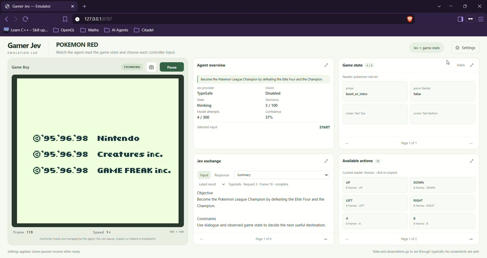
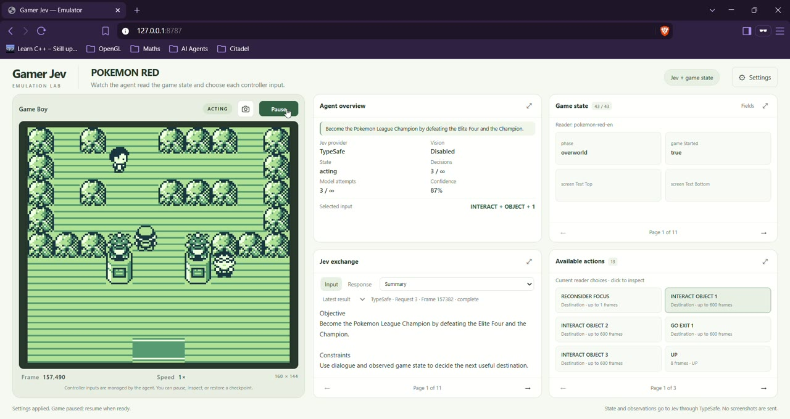

# Gamer Jev

Let [TypeSafe AI's Jev](https://typesafe.ai/) play Game Boy games in a local
emulator. Supply your own ROM, choose objectives, and watch Jev select actions
from the current game state, with optional visual observations.

The goal is to make it easy to try Jev with different games. Game-specific
knowledge lives in separate profiles, so adding another game does not require
changing the shared gameplay loop.

## Jev in action

See Jev playing Pokémon Red in the local viewer, alongside its selected actions
and the observed game state. [Watch the full gameplay videos on mikelpastor.com](https://mikelpastor.com/).

**Starting Pokémon Red**



**Inside the first Gym**



## What you can do

Watch or play in a local browser viewer with stereo sound, inspect Jev's
decisions and game state, and save or restore checkpoints. An included demo
and mock agent let you try the application offline without credentials.

Game Boy is the current target, with dedicated readers for exact English
Pokémon Red, Blue, and Yellow revisions. See [compatibility and current limits](docs/development.md#compatibility-and-current-limits)
for supported cartridges and validation details.

## Built with

- **TypeScript and Node.js** — strict typing and the shared gameplay runtime.
- **Serverboy 0.0.7** — Game Boy emulation.
- **HTML, CSS, JavaScript, and Web Audio** — the local viewer and stereo playback.
- **TypeSafe AI and Vercel AI Gateway** — Jev decisions and independently configured optional vision.

## Quick start

You need Node.js **22.18+**, npm, and a modern browser.

```sh
npm ci
npm start
```

Open the URL printed by the CLI, usually **http://127.0.0.1:8787**.
The application starts paused with the included demo. Add your own legally
obtained ROM to `roms/` and choose it in **Settings → ROMs**, or close Settings
and press **Resume** to try the demo.

For agent play, copy [`.env.example`](.env.example) to `.env` and add your provider
credentials before starting. In **Settings → Agent**, choose the mode and
models, set your objectives, apply the changes, and resume.
The [setup guide](docs/getting-started.md) and [agent guide](docs/agent-sessions.md)
cover the full configuration.

## Documentation

Browse the [documentation index](docs/README.md), or go directly to:

- [Agent sessions](docs/agent-sessions.md) — providers, objectives, limits, and logs.
- [Local viewer](docs/viewer.md) — controls, ROMs, sound, and checkpoints.
- [Development](docs/development.md) — headless execution, emulator APIs, compatibility, and checks.
- [Game-reader strategies](docs/game-readers.md) and [Pokémon support](docs/pokemon-readers.md).

## License and credits

GPL-2.0-only; see [LICENSE](LICENSE) and
[THIRD_PARTY_NOTICES.md](THIRD_PARTY_NOTICES.md). The emulator derives from
Serverboy and GameBoy-Online. The reference project is acknowledged as
inspiration; its Pokémon-specific harness is not part of this implementation.

Game Boy is a Nintendo trademark. This project is independent of Nintendo and
TypeSafe AI.
