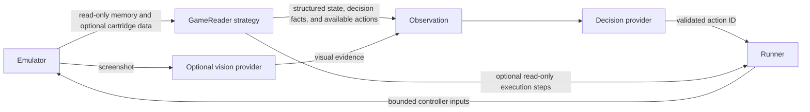

# Game-reader strategies

A memory address has meaning only for a particular game and ROM revision.
`GameReader` is the Strategy interface that owns that knowledge. The runtime
uses the same observation and decision loop for every registered reader.



The reader supplies facts and valid choices. Jev selects a choice. Vision only
describes screenshots. Manual mode can inspect the same local state and action
set without constructing either model provider.

## The contract

See [`GameReader`](../src/core/game-reader.ts) and the working
[`DemoGameReader`](../src/profiles/demo.ts).

```ts
interface GameReader {
  readonly descriptor: GameReaderDescriptor;
  readonly defaultObjectives?: Objectives;
  readState(memory: GameReaderMemory): GameStateData;
  availableActions(state: GameState, controllerActions: readonly AgentAction[]): readonly AgentAction[];
  setObjectives?(objectives: Objectives): void;
  createExecution?(memory: GameReaderMemory, action: AgentAction): GameActionExecution;
  shouldWait?(state: GameStateData, frame: number): boolean;
  onActionComplete?(event: CompletedGameAction): void;
  reset?(): void;
}
```

- `descriptor` identifies the reader, console, name, and supported ROM SHA-256
  hashes. Register each supported revision only after verifying its layout.
- Optional `defaultObjectives` supplies an editable goal, constraints, and up to
  16 milestones for a new session. It follows the same runtime validation as
  user objectives. CLI objectives and custom UI settings take precedence.
- `readState` receives `readMemory(address, length)` and optional read-only
  `readRom(offset, length)`. It returns named
  string, number, or boolean values and English descriptions explaining them.
  It does not receive private emulator internals, write access, or API credentials.
- `availableActions` derives valid choices from that state. It can filter the
  supplied controller actions or construct semantic actions such as confirming
  a menu item or approaching a destination. Each action uses supported buttons
  and bounded frames, directly or through an optional profile executor.
- `setObjectives` receives validated supplied objectives at activation, provider
  replacement, and runtime edits. A profile may recognize milestone text and
  report explicit checkpoint evidence. Preserve custom goals and constraints;
  unknown text must not be reported as verified.
- `reset` invalidates optional caches after reset or restore. Reads should be
  idempotent for the same emulator state; viewer inspection also invokes them.

The binding stamps the frame and reader ID, copies outputs, checks compatibility,
and validates state and actions. The session checks the selected ID against the
exact action set observed for that decision. A hardware-supported button can
still be unavailable in the current game state.

State values are limited to 64 named primitive fields; strings to 256 characters
and descriptions to 500. Action sets contain 1–255 unique IDs. Non-stop actions
advance 1–600 frames. Stop actions advance zero frames and press no buttons.
Use `wait` while the game initializes or a transition has no actionable choices.
Keep goal-completion checks separate from the model's opinion that it should stop.

Reader suggestions preload **Settings → Agent → Objectives**, including during
manual play. **Use game defaults** copies them into the draft; **Apply changes**
activates the edit through the normal revision-checked settings update. It
preserves ceilings, counters, and emulator state. Untouched reader suggestions
refresh when a different ROM is loaded; customized objectives carry over.
Agent startup can omit `--goal`/`--objectives` if its reader supplies defaults.
Readers without defaults still require a user objective before agent activation.

TypeScript readers can set an optional `AgentAction.availabilityKey`, a nonempty
string of at most 128 characters identifying the action's semantic context.
Keep action IDs stable and keys stable while that meaning is unchanged. For
example, `press_a` to advance dialogue must have a different key from `press_a`
to start an overworld interaction. Do not include frame numbers or partially
printing text: those changes should not invalidate a still-applicable choice.
Before execution, the runner compares this key as well as the current action's
buttons, duration, execution type, and stop flag. A changed context discards the response and
requests a fresh decision while continuous emulation continues. The discarded
response still counts toward session limits and remains inspectable in the log.

`GameStateData` can also include optional `decisionSupport`:

```ts
decisionSupport: {
  decisionGoal: "Reach the nearby door before continuing across this room.",
  facts: ["A door is visible at (7, 1)."],
  actionFacts: { press_right: ["This direction starts a route to that door."] },
}
```

This is profile-owned evidence, independent of the decision and vision providers.
Use it for verified mechanics, legal choices, interaction targets, or route
distances. A reader can delegate those calculations to an adjacent class under
its own profile directory; the shared runner does not interpret game rules.
Return at most 32 facts and 32 action IDs, with up to eight facts per ID and
500 characters per fact. The binding keeps action facts only for the choices
actually offered. Facts are advisory: supplying route evidence alone does not
choose a destination or execute a path.

Optional `decisionGoal` is a nonempty immediate task of at most 500 characters.
Jev's shared question considers it before distant milestones, while supplied
objectives and constraints remain authoritative. State and optional vision
observers preserve it; the shared runtime does not interpret it or choose an
action. Use current eligibility and resources when supplying a task, so future
preparation does not masquerade as something possible on the current screen.

### Optional destination execution

A TypeScript reader can offer an action with `execution: "profile"`, empty
`buttons`, a stable ID/context key, and a `frames` ceiling from 1 to 600.
If Jev selects it, the runner calls `createExecution` once. Its `next()` reads
fresh local state and returns either `{ done: false, buttons: [...] }` for one
frame or `{ done: true, reason: "..." }` to stop. The runner validates every
step, advances the emulator, enforces the ceiling, and adds four release frames.
The reader has no write/advance capability or provider credentials.

Keep the selected destination fixed. Replanning a mechanical route to that
destination is allowed; substituting another target or choosing a recovery
action is not. Stop for a dialogue, battle, changed map, or unavailable route
so Jev can make the next choice. `finish(reason)` optionally retains bounded
local outcome evidence. It runs once on completion or cancellation; pause,
settings edits, reset, restore, and shutdown discard the active execution.
Action records include actual frame ranges, state differences, and
`executionReason`. The viewer labels these actions as destination executors.

The optional `shouldWait` hook identifies mechanical settling that needs no
decision, such as a walking animation. The runner advances neutral frames
without calling Jev or vision, up to 600 frames between requests. After that
ceiling it requests a fresh decision even if the reader still reports busy.
It continues to enforce session time limits and cancellation. Do not use this
hook to choose gameplay inputs or bypass a dialogue that requires a choice.
Readers without these hooks retain the existing controller loop; declarative
JSON profiles do not provide executable code.

The optional `onActionComplete` hook receives the selected action, its actual
frame range and interruption status, and validated local before/after state
when available. It runs once per executed action through state and optional
vision observers; cancelled actions have no after-state. A reader can retain
bounded semantic outcome memory across maps or battles. This callback cannot
advance the emulator or choose another action. State differences alone do not
prove progress. Reset/restore and objective changes must invalidate relevant
memory. Profiles can also offer input-free semantic actions: Jev chooses a
purpose, a profile executor stores it and returns `done`, and later choices
remain with Jev. Normal release frames and session/request limits still apply.

`GameReaderMemory` always supplies `readMemory`. Its optional `readRom` capability
returns a copy of a slice of the loaded cartridge by absolute byte offset,
independent of the CPU's current ROM bank. The Game Boy adapter bounds each
slice to 16 KiB and validates the cartridge bounds. `romByteLength` supplies
optional cartridge-size metadata for validating table access. Use this to decode tables
from the user's own ROM rather than bundle extracted assets. No ROM bytes belong
in observations, logs, or browser-facing data. Memory-only adapters remain valid;
mark unsupported mechanics as unknown instead of inventing legality.

## Add a TypeScript reader

1. Create a class implementing `GameReader` under `src/profiles/<your-game>/`.
   Use verified addresses for the exact ROM revisions in its descriptor.
2. Implement `readState` for the needed facts, such as phase, menu entries,
   player coordinates, health, and inventory. Decode the game's actual data
   format; do not assume another game's layout or character encoding.
3. Implement `availableActions` for the current phase. For example, expose
   movement during exploration and menu navigation while a menu is open.
4. Register its descriptor and factory in
   [`createDefaultGameReaderRegistry`](../src/profiles/default-registry.ts):

   ```ts
   registry.register({
     descriptor: new YourGameReader().descriptor,
     create: () => new YourGameReader(),
   });
   ```

5. Test memory decoding, phase changes, action availability, incompatible ROMs,
   and reset/restore with synthetic or suitably licensed fixtures. Keep private
   ROMs and runtime game data out of the repository.

State observers expose the reader's synchronous local snapshot to the runner.
The runner uses it to recheck action availability and record state differences
between execution start and completion, without calling vision again. Shared
repetition feedback compares state values rather than frame numbers, detects
returns to earlier states across menus, and includes bounded changed fields in
action history. Custom observation providers can supply `readSnapshot` for this
behavior; screen-only observers report pixel changes with unknown state changes.
No game-specific recovery controls are selected by the runner.

The registry automatically selects a unique compatible reader. Use
`--profile <id>` when several readers match. `--list-profiles` lists registered
readers. Adding one requires its strategy and registration, without changes
to Jev, vision, or the session runner. Each factory creates an independent
instance; avoid global game-specific state.

## Use a JSON profile for simple layouts

[`examples/demo-profile.json`](../examples/demo-profile.json) is a complete,
tested profile for the original demo. The JSON adapter implements the same
Strategy interface; it does not use a separate decision loop.

```sh
npm start -- --demo --profile examples/demo-profile.json
npm start -- --demo --profile examples/demo-profile.json --agent typesafe --vision none --goal "Increase scrollX"
```

The first command enables manual inspection without credentials. The second
uses only Jev directly through TypeSafe. Supply `TYPESAFE_API_KEY` in `.env`, or
replace `typesafe` with `mock` to test offline. Use `--agent gateway` with a
Gateway key if you prefer Vercel for decisions. Vision is selected independently
with `--vision none|gateway|mock`; a disabled visual provider requires no key.

The schema requires `schemaVersion: 1`, `id`, `name`, `consoleId`, an array of
supported `romSha256` values, and `fields`. Profiles are at most 128 KiB.
Optional `defaultObjectives` uses `{ "goal": "...", "constraints": [],
"milestones": [] }`. Goals are limited to 2,000 characters; the lists allow at
most 16 nonempty entries of 500 characters each. They describe desired outcomes,
not automatically verified achievements.
Addresses and masks accept integers or hexadecimal strings such as `"0xC000"`.
The viewer's `/api/status` includes the loaded ROM hash.

| Field type | Decoding |
| --- | --- |
| `u8` | Unsigned byte |
| `i8` | Signed byte |
| `u16le` | Unsigned two-byte little-endian value |
| `u16be` | Unsigned two-byte big-endian value |
| `flag` | Boolean: any bit in the required `mask` is set |
| `enum` | Byte decoded with `labels`; unknown bytes stay numeric |

Each field has a unique `name`, `description`, `address`, and `type`. Enum label
keys are byte values. Use a TypeScript strategy for text encoding, pointers,
bank-dependent structures, variable-length lists, or other complex layouts.

Optional `actions` describe IDs, buttons, descriptions, optional frame durations,
and an optional `when` array. All conditions must match. Conditions use a field
name, `op`, and primitive `value`; supported operators are `eq`, `ne`, `lt`,
`lte`, `gt`, and `gte`. Ordered comparisons require numeric values. Unknown
properties, duplicate names, invalid conditions, and unsupported schemas fail
validation. Button compatibility is checked when an action set is read.

For example, an action can have this condition once its profile declares a
verified `phase` field:

```json
{ "field": "phase", "op": "eq", "value": "exploration" }
```

If `actions` is omitted, the reader supplies generic controller actions. If
present, only matching rules are offered, plus `wait` and `stop`. Those two IDs
are reserved. Rules without `frames` use `--action-frames`; explicit durations
override that default. Pressed buttons are released for four frames afterward.

## Inspect and validate

Open **Game state** in the viewer, or read `GET /api/game-state`, to inspect
the current state, field descriptions, and available actions. Inspection does
not advance frames or make model calls. Without a compatible reader, it shows
explicitly labeled emulator metadata rather than invented game mechanics.

Agent runs automatically record reader diagnostics in the local JSONL path
printed at startup. Add `--debug` to see them in the terminal, or to enable a
record for manual play. `game-reader` events include the selected reader and
ROM hash, changed semantic state and available actions, cache resets, and the
stage and reason of a read failure. Repeated reads of unchanged state are not
logged again. Inspection and diagnostics do not advance frames or call models;
they do not modify the state sent to Jev. Readers receive an optional diagnostic
sink through the binding layer, so existing strategies need no changes.

The Game Boy adapter reads through the backend's mapped memory API. Readable
work RAM and interpreted I/O registers are useful for profiles. In the pinned
backend, VRAM can return access-restricted values while the LCD is active.
The demo therefore exposes its readiness flag in work RAM at `0xC000`; its
scroll state comes from `0xFF43` and `0xFF42`. These meanings belong to the demo
strategy, not the shared runtime. The new readiness flag changes the demo ROM
hash, so checkpoints from its earlier version are incompatible.

Shipped readers cover the original demo and exact English Pokémon Red, Blue,
and Yellow revisions documented in [Pokémon readers](pokemon-readers.md).
Their Gen I decoding is shared separately from revision-specific hashes and
layouts. Profile-local adjuncts such as `PokemonPreparationSupport` can turn
decoded health, resources and upcoming challenges into bounded advisory facts
and action descriptions, while the reader keeps current legality and execution.
These adjuncts neither call models nor select controller inputs. Other games need their own verified reader or can use generic
controller actions with vision.
No shared memory map can determine valid gameplay choices for arbitrary ROMs.
