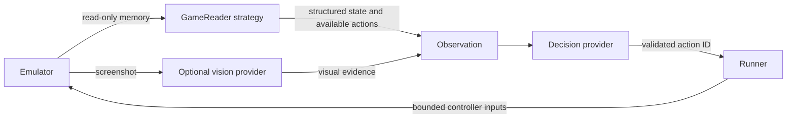

# Game-reader strategies

A memory address has meaning only for a particular game and ROM revision.
`GameReader` is the Strategy interface that owns that knowledge. The runtime
uses the same observation and decision loop for every registered reader.



The reader supplies facts and valid choices. Jev selects a choice. Vision only
describes screenshots. Manual mode can inspect the same local state and action
set without constructing either model provider.

## The contract

See [`GameReader`](../src/core/game-reader.ts) and the working
[`DemoGameReader`](../src/profiles/demo.ts).

```ts
interface GameReader {
  readonly descriptor: GameReaderDescriptor;
  readState(memory: MemoryReader): GameStateData;
  availableActions(state: GameState, controllerActions: readonly AgentAction[]): readonly AgentAction[];
  reset?(): void;
}
```

- `descriptor` identifies the reader, console, name, and supported ROM SHA-256
  hashes. Register each supported revision only after verifying its layout.
- `readState` receives only `readMemory(address, length)`. It returns named
  string, number, or boolean values and English descriptions explaining them.
  It does not receive private emulator internals, write access, or API credentials.
- `availableActions` derives valid choices from that state. It can filter the
  supplied controller actions or construct semantic actions such as confirming
  a menu item. Each action still maps to supported buttons and bounded frames.
- `reset` invalidates optional caches after reset or restore. Reads should be
  idempotent for the same emulator state; viewer inspection also invokes them.

The binding stamps the frame and reader ID, copies outputs, checks compatibility,
and validates state and actions. The session checks the selected ID against the
exact action set observed for that decision. A hardware-supported button can
still be unavailable in the current game state.

State values are limited to 64 named primitive fields; strings to 256 characters
and descriptions to 500. Action sets contain 1–255 unique IDs. Non-stop actions
advance 1–600 frames. Stop actions advance zero frames and press no buttons.
Use `wait` while the game initializes or a transition has no actionable choices.
Keep goal-completion checks separate from the model's opinion that it should stop.

## Add a TypeScript reader

1. Create a class implementing `GameReader` under `src/profiles/<your-game>/`.
   Use verified addresses for the exact ROM revisions in its descriptor.
2. Implement `readState` for the needed facts, such as phase, menu entries,
   player coordinates, health, and inventory. Decode the game's actual data
   format; do not assume another game's layout or character encoding.
3. Implement `availableActions` for the current phase. For example, expose
   movement during exploration and menu navigation while a menu is open.
4. Register its descriptor and factory in
   [`createDefaultGameReaderRegistry`](../src/profiles/default-registry.ts):

   ```ts
   registry.register({
     descriptor: new YourGameReader().descriptor,
     create: () => new YourGameReader(),
   });
   ```

5. Test memory decoding, phase changes, action availability, incompatible ROMs,
   and reset/restore with synthetic or suitably licensed fixtures. Keep private
   ROMs and runtime game data out of the repository.

The registry automatically selects a unique compatible reader. Use
`--profile <id>` when several readers match. `--list-profiles` lists registered
readers. Adding one requires its strategy and registration, without changes
to Jev, vision, or the session runner. Each factory creates an independent
instance; avoid global game-specific state.

## Use a JSON profile for simple layouts

[`examples/demo-profile.json`](../examples/demo-profile.json) is a complete,
tested profile for the original demo. The JSON adapter implements the same
Strategy interface; it does not use a separate decision loop.

```sh
npm start -- --demo --profile examples/demo-profile.json
npm start -- --demo --profile examples/demo-profile.json --agent typesafe --vision none --goal "Increase scrollX"
```

The first command enables manual inspection without credentials. The second
uses only Jev directly through TypeSafe. Supply `TYPESAFE_API_KEY` in `.env`, or
replace `typesafe` with `mock` to test offline. Use `--agent gateway` with a
Gateway key if you prefer Vercel for decisions. Vision is selected independently
with `--vision none|gateway|mock`; a disabled visual provider requires no key.

The schema requires `schemaVersion: 1`, `id`, `name`, `consoleId`, an array of
supported `romSha256` values, and `fields`. Profiles are at most 128 KiB.
Addresses and masks accept integers or hexadecimal strings such as `"0xC000"`.
The viewer's `/api/status` includes the loaded ROM hash.

| Field type | Decoding |
| --- | --- |
| `u8` | Unsigned byte |
| `i8` | Signed byte |
| `u16le` | Unsigned two-byte little-endian value |
| `u16be` | Unsigned two-byte big-endian value |
| `flag` | Boolean: any bit in the required `mask` is set |
| `enum` | Byte decoded with `labels`; unknown bytes stay numeric |

Each field has a unique `name`, `description`, `address`, and `type`. Enum label
keys are byte values. Use a TypeScript strategy for text encoding, pointers,
bank-dependent structures, variable-length lists, or other complex layouts.

Optional `actions` describe IDs, buttons, descriptions, optional frame durations,
and an optional `when` array. All conditions must match. Conditions use a field
name, `op`, and primitive `value`; supported operators are `eq`, `ne`, `lt`,
`lte`, `gt`, and `gte`. Ordered comparisons require numeric values. Unknown
properties, duplicate names, invalid conditions, and unsupported schemas fail
validation. Button compatibility is checked when an action set is read.

For example, an action can have this condition once its profile declares a
verified `phase` field:

```json
{ "field": "phase", "op": "eq", "value": "exploration" }
```

If `actions` is omitted, the reader supplies generic controller actions. If
present, only matching rules are offered, plus `wait` and `stop`. Those two IDs
are reserved. Rules without `frames` use `--action-frames`; explicit durations
override that default. Pressed buttons are released for four frames afterward.

## Inspect and validate

Open **Local game state** in the viewer, or read `GET /api/game-state`, to inspect
the current state, field descriptions, and available actions. Inspection does
not advance frames or make model calls. Without a compatible reader, it shows
explicitly labeled emulator metadata rather than invented game mechanics.

The Game Boy adapter reads through the backend's mapped memory API. Readable
work RAM and interpreted I/O registers are useful for profiles. In the pinned
backend, VRAM can return access-restricted values while the LCD is active.
The demo therefore exposes its readiness flag in work RAM at `0xC000`; its
scroll state comes from `0xFF43` and `0xFF42`. These meanings belong to the demo
strategy, not the shared runtime. The new readiness flag changes the demo ROM
hash, so checkpoints from its earlier version are incompatible.

Only the original demo has a shipped, verified game reader. Other games need
their own verified reader or can use generic controller actions with vision.
No shared memory map can determine valid gameplay choices for arbitrary ROMs.
